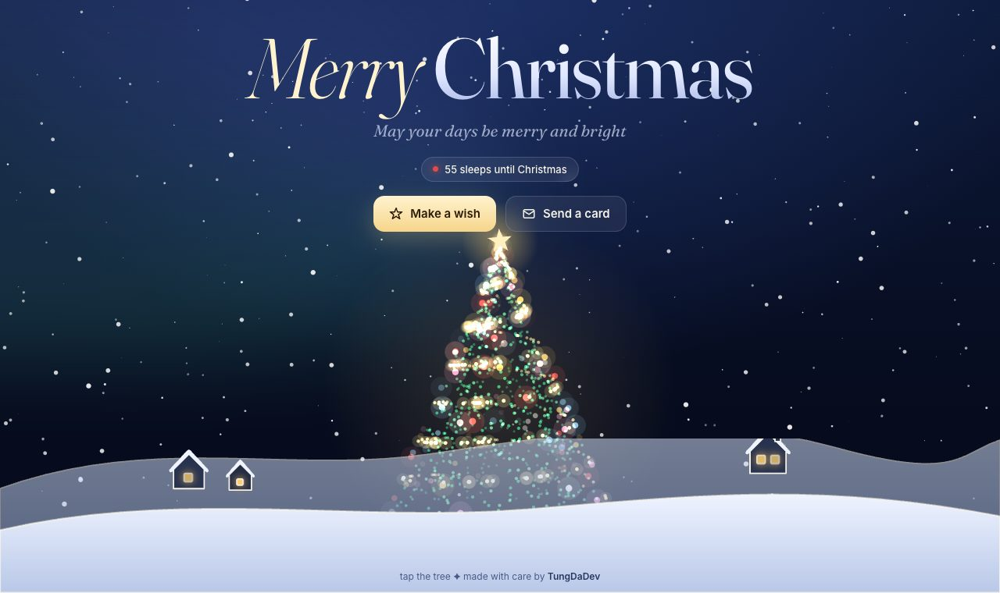

<div align="center">

# 🎄 Merry Christmas

A little Christmas card you can send to someone you love.

**[christmas.tungdadev.com](https://christmas.tungdadev.com/)**

<a href="https://christmas.tungdadev.com/"></a>

</div>

## What's inside

- A glowing 3D particle tree that slowly turns — tap anywhere to sparkle and spin it faster
- Twinkling sky, aurora, layered snow and a snowy village with lit windows
- **Make a wish** sends a shooting star; a chip counts the sleeps until Christmas
- **Send a card:** build a personal link, copy it, or share it from your phone
- Respects `prefers-reduced-motion`

## Send a personal card

Add your own words to the link:

```
https://christmas.tungdadev.com/?to=Mia&from=Tung&msg=Wishing%20you%20a%20cosy%20Christmas
```

| Parameter | Shows |
|---|---|
| `to` | Who the card is for |
| `from` | Who it's from |
| `msg` | A short line from you |

Or just press **Send a card** on the page and fill in the form.

## Run it locally

Plain HTML, CSS and canvas — no build step, no images to load.

```sh
git clone https://github.com/bthanhtung/merry-christmas.git
cd merry-christmas
npx serve .        # or simply open index.html
```

To host your own copy, drop the folder on [Netlify Drop](https://app.netlify.com/drop) or turn on GitHub Pages.

## License

[MIT](LICENSE) © 2024–2026 TungDaDev
